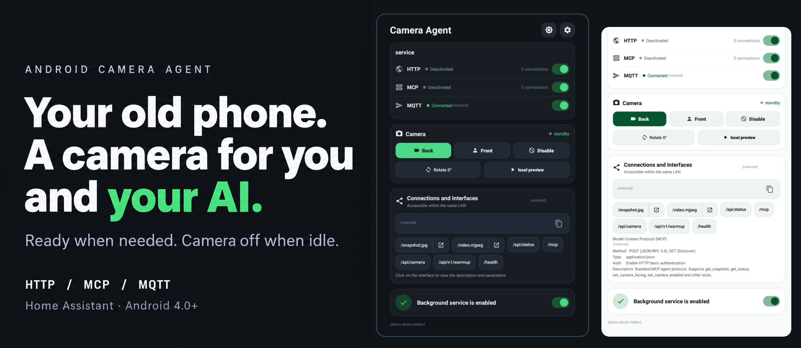
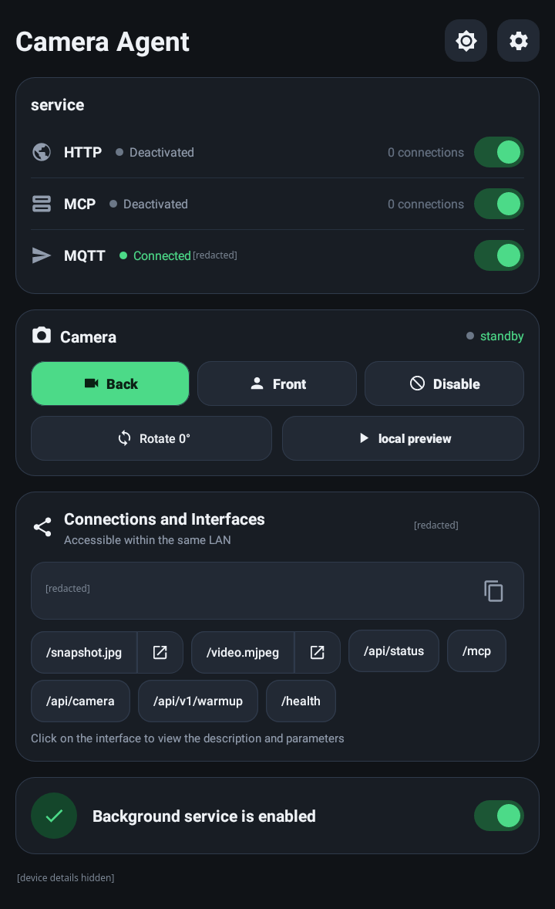
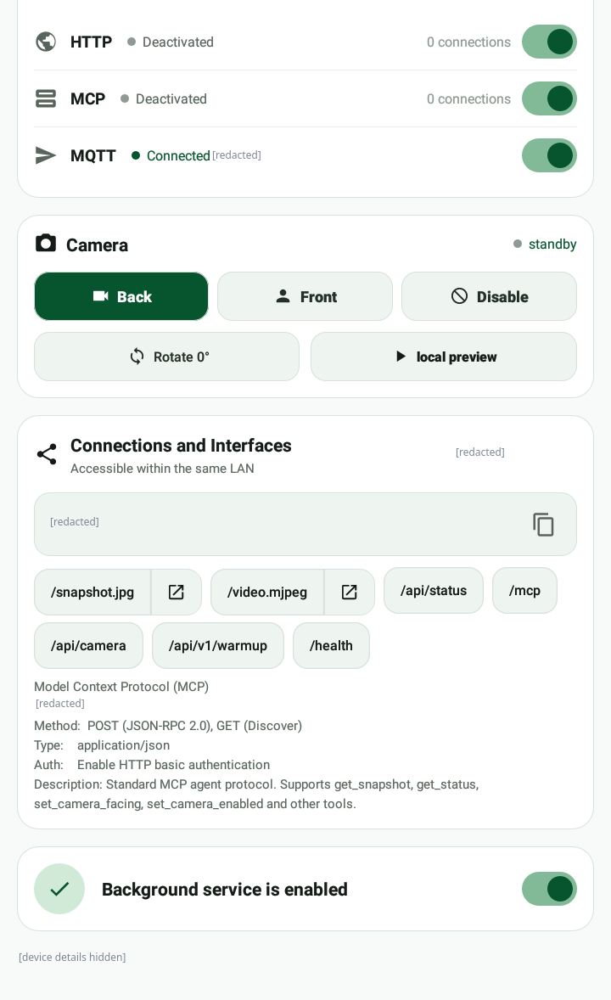
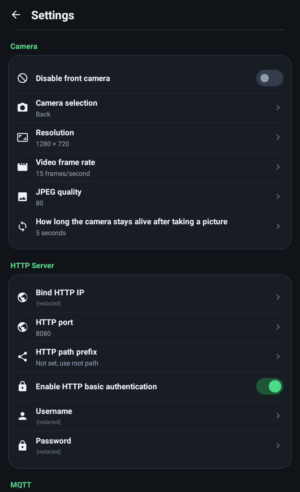

# Android Camera Agent

[中文](README.zh.md) · [User guide](DETAIL.md) · [Download APK](https://github.com/ctxinf/android-camera-agent/releases)

Turn a spare Android phone into an on-demand camera. View and control it yourself, let an AI agent use it through MCP, or connect it to Home Assistant.

Screenshots

  
  
  

[All screenshots](assets/screenshots/README.md)

## What it does

- **HTTP:** remote snapshots, MJPEG video, status, and camera controls.
- **MCP server:** give AI agents camera access and control.
- **Home Assistant:** video via **MJPEG IP Camera**, entities and controls via **MQTT discovery**.
- **On-demand camera:** releases the camera when idle to reduce battery use, heat, and unnecessary capture.

Native Android. Runs in the background with the screen off. Supports old phones, down to **Android 4.0**.

## Install

Get an APK from [GitHub Releases](https://github.com/ctxinf/android-camera-agent/releases): **Android 8.0+** for newer phones, **Legacy (Android 4.0+)** for older ones.

Install, grant camera permission, and use the connection URLs shown in the app. [Setup and integrations →](DETAIL.md)

## Compared with

| | Camera Agent | DroidCam (Classic) | Android IP Camera |
| --- | --- | --- | --- |
| Main use | Remote control & automation | PC webcam, audio + video | Network camera & recording |
| Access | HTTP · MCP · MQTT | PC client + webcam drivers; HTTP video | HTTP controls; H.264 / MJPEG |
| Camera use | Opens on demand, releases when idle | Webcam sessions | Streaming & recording |

References: [DroidCam](https://www.dev47apps.com/), [HTTP video](https://www.dev47apps.com/droidcam/connect/), [Android IP Camera](https://github.com/DigitallyRefined/android-ip-camera). [More comparison notes](DETAIL.md#comparison).
