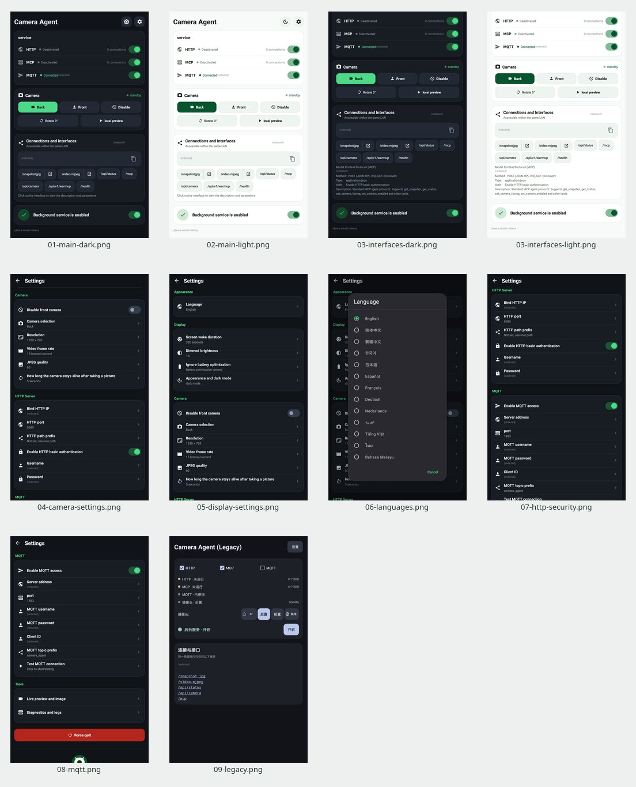

# Actual screenshots / 实际截图

Captured on a Huawei KNT-AL20 running Android 8.0, on 2026-10-21. Each image preserves the full app viewport at **720 × 1178**, with only the status and system navigation bars removed. Scrollable pages show one screen at a time. Addresses, account fields, passwords, and device identifiers are redacted. These are real app screens, without generated UI or altered service states.

真机截图，保留完整应用区域，仅去除系统栏并遮盖隐私信息。为使主要设置完整入镜，拍摄时临时使用 200 dpi；手机原显示设置已恢复。Legacy 也在这台 Android 8.0 设备上拍摄，不代表 Android 4.0 实机验证。

| File | Screen / 内容 |
| --- | --- |
| [01-main-dark.png](01-main-dark.png) | Full home screen, dark / 深色完整主页 |
| [02-main-light.png](02-main-light.png) | Full home screen, light / 浅色完整主页 |
| [03-interfaces-dark.png](03-interfaces-dark.png) | Endpoints and MCP description, dark / 深色接口与 MCP 说明 |
| [03-interfaces-light.png](03-interfaces-light.png) | Endpoints and MCP description, light / 浅色接口与 MCP 说明 |
| [04-camera-settings.png](04-camera-settings.png) | Camera settings / 镜头、分辨率、帧率、质量与保活 |
| [05-display-settings.png](05-display-settings.png) | Display and appearance / 显示与外观 |
| [06-languages.png](06-languages.png) | Language picker / 语言选择 |
| [07-http-security.png](07-http-security.png) | HTTP and authentication / HTTP 与鉴权 |
| [08-mqtt.png](08-mqtt.png) | MQTT settings / MQTT 设置 |
| [09-legacy.png](09-legacy.png) | Legacy home screen / Legacy 完整主页 |

HTTP/MCP are deactivated and MQTT is connected in the modern screenshots; the Legacy screenshot shows HTTP/MCP not running and MQTT disabled. These are the actual capture-time states. The [README banner](../branding/readme-hero.png) is a separate promotional composition; its screen panels use the screenshots above.
